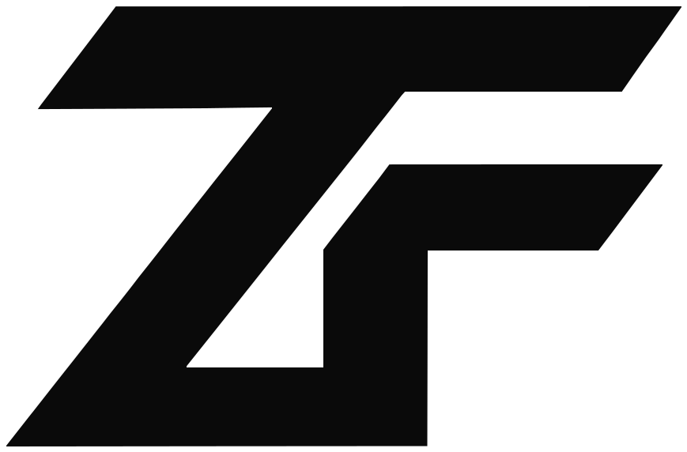
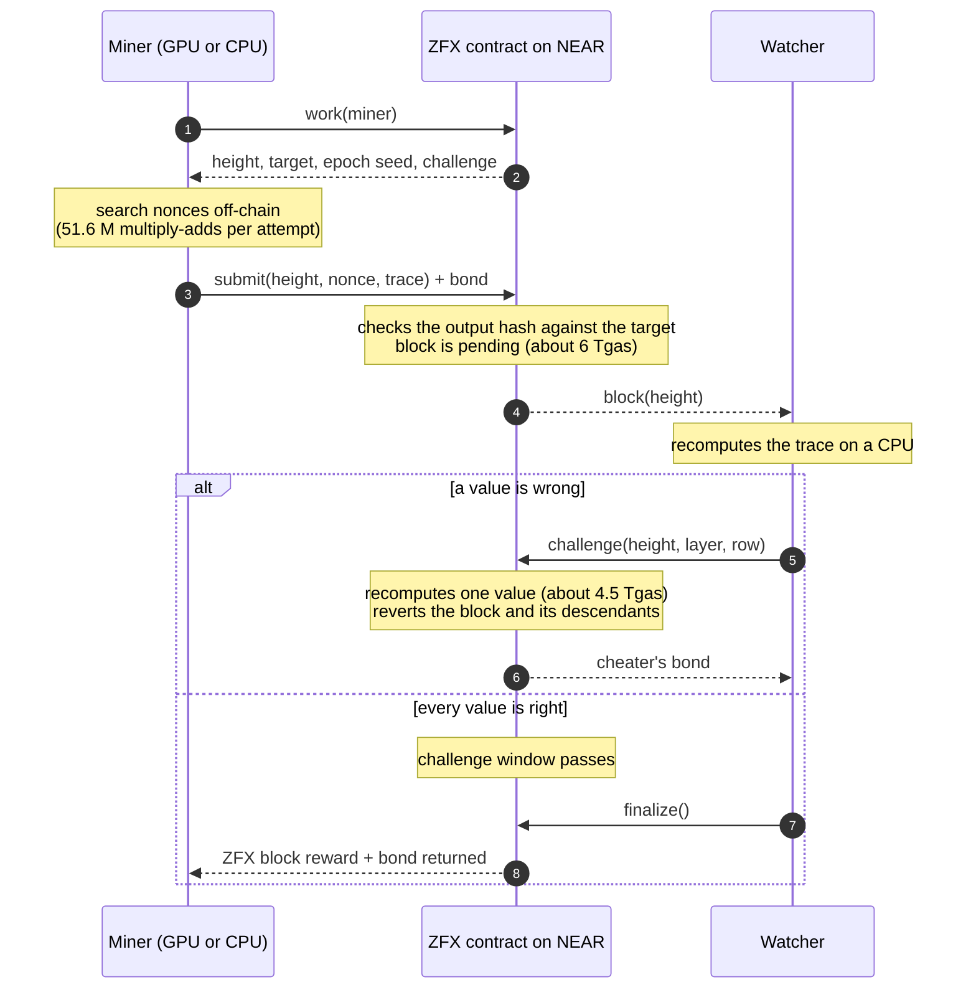
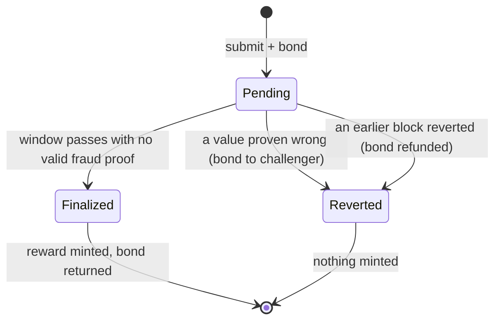

<p align="center">
  <picture>
    <source media="(prefers-color-scheme: dark)" srcset="docs/assets/logo-dark.svg">
    
  </picture>
</p>

# ZeroFlux

**ZeroFlux is the economic layer for AI compute.** Earn from idle hardware. Build privately with AI. Trade AI demand.

| | Product | What it is | State |
|---|---|---|---|
| **Earn** | [ZFX Mining](#earn-zfx-mining) | Proof of work made of the integer matrix math AI chips run fastest. ZFX is a NEAR token minted only for mined blocks; NEAR referees every block | Live on NEAR testnet at `zfx.zeroflux.testnet` |
| **Build** | [ZFX VPN](vpn/README.md) | A private AI endpoint for the models you already use: keeps your users' data and your own coding-agent sessions out of model prompts | Local app (macOS); hosted gateway built, not hosted publicly |
| **Trade** | [ZFX Markets](markets/README.md) | A daily index of AI model demand from OpenRouter usage, and perpetuals on it that clear on NEAR | Index published daily; perps on NEAR testnet, paper only |

Site: [zeroflux.network](https://zeroflux.network). Docs: [zeroflux.network/docs](https://zeroflux.network/docs/) (every page also as Markdown; [llms.txt](https://zeroflux.network/llms.txt)).

```
TESTNET ONLY      MAINNET_READY = false      no monetary value      no real-money trading
```

### At a glance

- **Three products, all running.** Mining is live on NEAR testnet; the VPN installs with one command; the markets index updates every day and its traded series is pushed to an on-chain oracle.
- **Proof of work for AI hardware.** One attempt is 51.6 million integer multiply-adds. Measured: NVIDIA H100 8.08 M attempts/s, AMD MI355X 13.1 M/s, Apple M5 Pro GPU 80 K/s vs 3.3 K/s on its CPU. Bit-exact across Rust, C++, CUDA, HIP, NumPy, MLX and MPS.
- **NEAR checks blocks without redoing them.** A block costs about 6 Tgas to submit; a fraud proof recomputes one value for about 4.5 Tgas and takes the cheater's bond. On testnet: [47 blocks finalized, 2,350 ZFX minted](https://testnet.nearblocks.io/address/zfx.zeroflux.testnet).
- **Privacy you can check.** ZFX VPN's tests record the exact bytes that reach the model provider and assert that no critical value, and no placeholder map, ever does (206 tests).
- **A market for AI demand.** 54 models indexed from OpenRouter's documented dataset (history from 2025-01-01), ed25519-signed daily prints, [an on-chain oracle](https://testnet.nearblocks.io/address/oracle.zeroflux.testnet), and [28 perpetual markets](https://testnet.nearblocks.io/address/perps-v2.zeroflux.testnet) whose contract re-verifies both traders' signed orders on every fill. Pushing Claude Opus 5.5's index 1% means buying about $43K of real usage, and open interest is capped below what a push costs.
- **About 550 automated tests**, plus end-to-end runs on a local NEAR sandbox and on public testnet.

**How it works:** [docs/ARCHITECTURE.md](docs/ARCHITECTURE.md) (diagrams of all three products). **Evaluating this repository?** Start with [AGENTS.md](AGENTS.md): claims, the command that checks each one, and what it should print. A two-minute check needs no build: `scripts/view-testnet.sh zfx.zeroflux.testnet stats '{}'`.

## Earn: ZFX Mining

ZFX is created only by proof of work, and the work is the computation AI accelerators are built for: batched int8/FP8 matrix multiplies. Miners run it on NVIDIA and AMD data-center GPUs, Apple Silicon or any CPU. NEAR holds the ledger and referees every block: a block is accepted unless someone proves it wrong within a challenge window, and a fraud proof needs NEAR to recompute only one value.

### Mine on NEAR testnet

```
cargo build --release
near account create-account sponsor-by-faucet-service you.testnet \
  autogenerate-new-keypair save-to-legacy-keychain network-config testnet create   # free, from the official faucet
scripts/mine-testnet.sh you.testnet mlx      # or cpu, mps, cuda, hip
```

The script registers the account with the token, then runs the mining proxy, a watcher, a finalizer and the miner. Each pending block holds a 0.25 NEAR bond for its 10-minute challenge window, so keep about 4 NEAR in the account; the faucet gives 10.

### How it works

1. **Mine off-chain.** Each attempt runs a 64 → 4096 → 4096 → 4096 → 4096 → 256 network of integer matrix layers (51.6 M multiply-adds) and hashes the output. A block is found when the hash is below the target. The challenge commits to the miner's NEAR account, so a found solution is useless to anyone else.
2. **Submit to NEAR** (`zfx-mine-opt` contract, about 6 Tgas). The miner posts the nonce, the four intermediate layers and the outputs of the winning attempt, plus a bond. The contract checks the output hash against the target and keeps the block pending.
3. **Anyone can challenge.** A watcher recomputes each pending block on a CPU in milliseconds. If one value is wrong, it calls `challenge(height, layer, row)`; the contract regenerates one weight row, recomputes that value (about 4.5 Tgas), and if it differs reverts the block and everything built on it, paying the bond to the challenger.
4. **Finalize.** After the window, the reward is minted to the miner and the bond returned. Difficulty retargets on-chain every block.
5. **Use it on NEAR.** ZFX is a standard NEP-141 token: NEAR wallets, transfers and NEAR Intents work directly, with no bridge.





Security assumption: at least one honest watcher checks pending blocks within the window (the watcher ships with the mining tools, and catching fraud pays the cheater's bond).

### Run everything locally

```
cargo build --release && make -C miner/cuda cpu
./target/release/zfx-miner selftest                     # bit-exact against the published vectors
make localnet                                         # NEAR sandbox + ZFX contract + watcher + mining proxies
./target/release/zfx-miner mine --node http://127.0.0.1:9561              # CPU
./target/release/zfx-miner mine --node http://127.0.0.1:9561 \
    --backend exec --exec ".venv/bin/python miner/python/zpu_miner.py --backend mlx"   # Apple GPU
```

GPU miners: `make -C miner/cuda cuda` or `make -C miner/cuda hip`, then `--backend exec --exec "miner/cuda/build/zpu-miner-cuda --backend gpu --gemm blas-int8"`. See `docs/HARDWARE.md`.

Prerequisites: Rust 1.90+, `cargo-near`, a C++17 compiler, Python 3.11+ with `uv` (`uv venv .venv && uv pip install --python .venv/bin/python numpy jsonschema websockets ziglang`, plus `torch`/`mlx` for Apple GPUs). The NEAR sandbox needs liblzma; see `docs/OPERATOR_RUNBOOK.md`.

## Build: ZFX VPN

```
curl -fsSL https://raw.githubusercontent.com/zerofluxprotocol/zeroflux/main/vpn/install.sh | sh
zfx-vpn init && zfx-vpn connect test
export OPENAI_BASE_URL=http://127.0.0.1:8787/v1
```

Details, modes and privacy tiers: [vpn/README.md](vpn/README.md). Threat model: [docs/VPN_THREAT_MODEL.md](docs/VPN_THREAT_MODEL.md). Prompt VPN installs upgrade in place and the `promptvpn` command keeps working.

## Trade: ZFX Markets

See [markets/README.md](markets/README.md): the index ([docs/DATA_METHOD.md](docs/DATA_METHOD.md)) and the `zfx-perps` exchange ([docs/ORDERBOOK_AND_CLEARING.md](docs/ORDERBOOK_AND_CLEARING.md), [docs/MARKET_RISK.md](docs/MARKET_RISK.md)).

## Tests

| command | what it runs |
|---|---|
| `make check` | lint, unit tests, contract builds, golden vectors in Rust, C++, Python, MLX, MPS, GPU device compile |
| `make e2e-near` | ZFX mining on NEAR with fraud proofs (honest miners, cheaters at every layer, reverts, finalization), ZFX on NEAR Intents, plus the alternatives below |
| `make security-test` | fuzzing, sanitizers, dependency audit, SBOM, license gate, reproducible build |
| `make gpu-test` | every GPU backend on this host |
| `make acceptance` | everything, then `ACCEPTANCE_REPORT.md` |
| `cd vpn && sh scripts/check.sh` | ZFX VPN: lint, 206 Rust tests (daemon, hosted gateway, migration, streaming red team, TEE gates), dashboard build, schemas |
| see [markets/README.md](markets/README.md#tests) | ZFX Markets: index and oracle contract, zfx-perps engine, clearing contract, sandbox end to end, TS SDK |

## Where things are

| path | contents |
|---|---|
| `bridge/near/zfx-mine-opt` | the ZFX contract: NEP-141 token, optimistic proof-of-work checking, bonds, fraud proofs |
| `bridge/near/near-pow` | the consensus PoW code compiled for NEAR contracts |
| `crates/zfx-verify` | proof of work, test vectors, difficulty |
| `miner/` | `zfx-miner` (Rust; also installed as `zpu-cli`), `zpu-miner` (C++ CPU/CUDA/HIP), `zpu_miner.py` (NumPy/PyTorch/MLX) |
| `bridge/relayers` | `zfx-bridge`: mining proxy, watcher, NEAR client and tools |
| `bridge/intents` | NEAR Intents adapter and test solver |
| `deploy/near_local.py`, `scripts/deploy_testnet.py`, `scripts/mine-testnet.sh` | local stack, testnet deployment, testnet mining |
| `vpn/` | ZFX VPN: local daemon and CLI (`zfx-vpn`), dashboard, hosted gateway (`vpn/hosted`), demos |
| `markets/index/` | ZFX Markets index: ingestion, ledger, formula, signed oracle prints, publisher, API |
| `markets/zfx-perps/` | ZFX Markets exchange: matching engine, node, NEAR clearing contract, SDKs |
| `site/` | zeroflux.network: pages, partials and the docs renderer |
| `docs/` | `REPO_AUDIT.md`, `RELEASE_READINESS.md`, `NEAR_SETTLEMENT.md` (design and measured gas), `CONSENSUS.md`, `ALGORITHM_DECISION.md`, `HARDWARE.md`, `THREAT_MODEL.md`, others |

### Alternatives, kept and tested

- **Own chain with a committee bridge**: `crates/zfx-node`, `crates/zfx-wallet`, `bridge/near/wzfx`, relayers and coordinator (`make e2e-native`, `make e2e-bridge`, `make localnet-bridge`).
- **NEAR checks every block in full** with a smaller proof-of-work profile: `bridge/near/zfx-mine` (146 Tgas per block; smaller GPU advantage).
- **PoW light client of a ZeroFlux chain on NEAR**: `bridge/near/zfx-light` (148 Tgas per header, committee-free deposits).

License: Apache-2.0.
