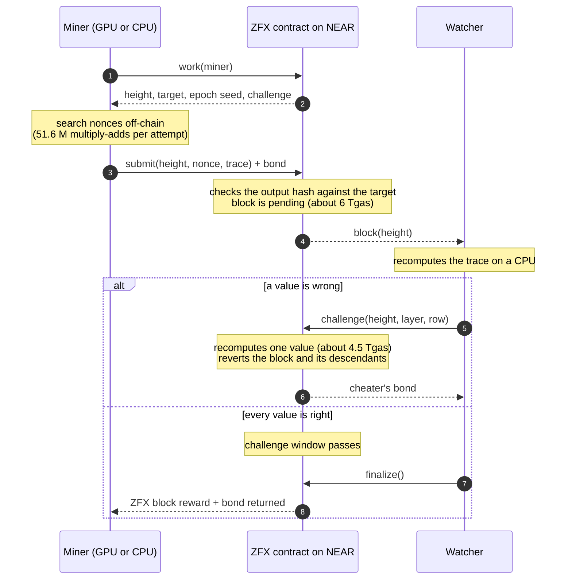
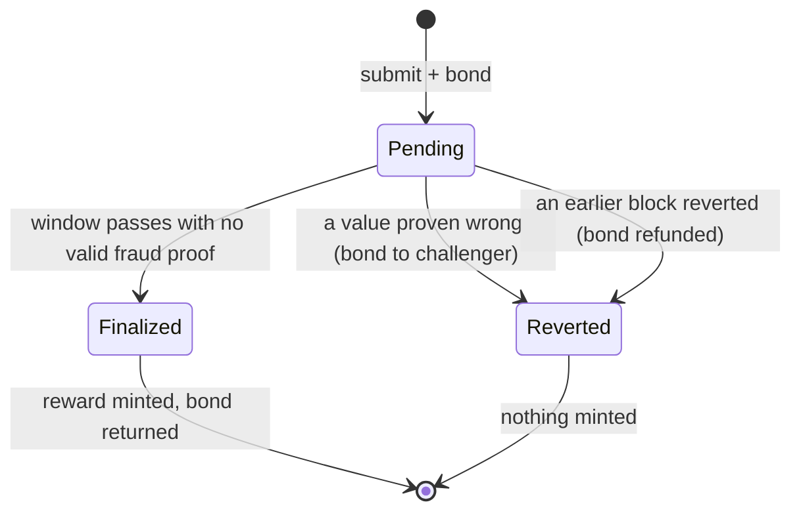

<p align="center">
  <picture>
    <source media="(prefers-color-scheme: dark)" srcset="docs/assets/logo-dark.svg">
    
  </picture>
</p>

# ZeroFlux (ZFX)

ZeroFlux is a proof-of-work network on NEAR. ZFX is its token, created only by proof of work, and the work is the computation AI accelerators are built for: batched int8/FP8 matrix multiplies. Miners run it on NVIDIA and AMD data-center GPUs, Apple Silicon or any CPU. NEAR holds the ledger and referees every block: a block is accepted unless someone proves it wrong within a challenge window, and a fraud proof needs NEAR to recompute only one value.

```
TESTNET ONLY      MAINNET_READY = false      no monetary value
```

## How it works

1. **Mine off-chain.** Each attempt runs a 64 → 4096 → 4096 → 4096 → 4096 → 256 network of integer matrix layers (51.6 M multiply-adds) and hashes the output. A block is found when the hash is below the target. The challenge commits to the miner's NEAR account, so a found solution is useless to anyone else.
2. **Submit to NEAR** (`zfx-mine-opt` contract, about 6 Tgas). The miner posts the nonce, the four intermediate layers and the outputs of the winning attempt, plus a bond. The contract checks the output hash against the target and keeps the block pending.
3. **Anyone can challenge.** A watcher recomputes each pending block on a CPU in milliseconds. If one value is wrong, it calls `challenge(height, layer, row)`; the contract regenerates one weight row, recomputes that value (about 4.5 Tgas), and if it differs reverts the block and everything built on it, paying the bond to the challenger.
4. **Finalize.** After the window, the reward is minted to the miner and the bond returned. Difficulty retargets on-chain every block.
5. **Use it on NEAR.** ZFX is a standard NEP-141 token: NEAR wallets, transfers and NEAR Intents work directly, with no bridge.





Security assumption: at least one honest watcher checks pending blocks within the window (the watcher ships with the mining tools, and catching fraud pays the cheater's bond).

## Quick start

```
cargo build --release && make -C miner/cuda cpu
./target/release/zpu-cli selftest                     # bit-exact against the published vectors
make localnet                                         # NEAR sandbox + ZFX contract + watcher + mining proxies
./target/release/zpu-cli mine --node http://127.0.0.1:9561              # CPU
./target/release/zpu-cli mine --node http://127.0.0.1:9561 \
    --backend exec --exec ".venv/bin/python miner/python/zpu_miner.py --backend mlx"   # Apple GPU
```

GPU miners: `make -C miner/cuda cuda` or `make -C miner/cuda hip`, then `--backend exec --exec "miner/cuda/build/zpu-miner-cuda --backend gpu --gemm blas-int8"`. See `docs/HARDWARE.md`.

Prerequisites: Rust 1.90+, `cargo-near`, a C++17 compiler, Python 3.11+ with `uv` (`uv venv .venv && uv pip install --python .venv/bin/python numpy jsonschema websockets ziglang`, plus `torch`/`mlx` for Apple GPUs). The NEAR sandbox needs liblzma; see `docs/OPERATOR_RUNBOOK.md`.

## Tests

| command | what it runs |
|---|---|
| `make check` | lint, unit tests, contract builds, golden vectors in Rust, C++, Python, MLX, MPS, GPU device compile |
| `make e2e-near` | ZFX mining on NEAR with fraud proofs (honest miners, cheaters at every layer, reverts, finalization), ZFX on NEAR Intents, plus the alternatives below |
| `make security-test` | fuzzing, sanitizers, dependency audit, SBOM, license gate, reproducible build |
| `make gpu-test` | every GPU backend on this host |
| `make acceptance` | everything, then `ACCEPTANCE_REPORT.md` |

## Where things are

| path | contents |
|---|---|
| `bridge/near/zfx-mine-opt` | the ZFX contract: NEP-141 token, optimistic proof-of-work checking, bonds, fraud proofs |
| `bridge/near/near-pow` | the consensus PoW code compiled for NEAR contracts |
| `crates/zfx-verify` | proof of work, test vectors, difficulty |
| `miner/` | `zpu-cli` (Rust), `zpu-miner` (C++ CPU/CUDA/HIP), `zpu_miner.py` (NumPy/PyTorch/MLX) |
| `bridge/relayers` | `zfx-bridge`: mining proxy, watcher, NEAR client and tools |
| `bridge/intents` | NEAR Intents adapter and test solver |
| `deploy/near_local.py`, `scripts/deploy_testnet.py` | local stack and testnet deployment |
| `docs/` | `NEAR_SETTLEMENT.md` (design and measured gas), `CONSENSUS.md`, `ALGORITHM_DECISION.md`, `HARDWARE.md`, `THREAT_MODEL.md`, others |

### Alternatives, kept and tested

- **Own chain with a committee bridge**: `crates/zfx-node`, `crates/zfx-wallet`, `bridge/near/wzfx`, relayers and coordinator (`make e2e-native`, `make e2e-bridge`, `make localnet-bridge`).
- **NEAR checks every block in full** with a smaller proof-of-work profile: `bridge/near/zfx-mine` (146 Tgas per block; smaller GPU advantage).
- **PoW light client of a ZeroFlux chain on NEAR**: `bridge/near/zfx-light` (148 Tgas per header, committee-free deposits).

License: Apache-2.0.
