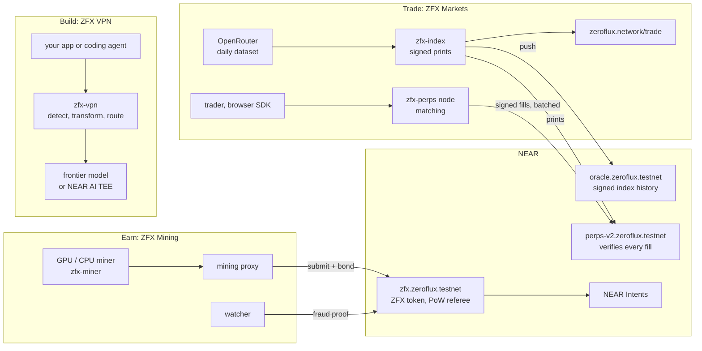
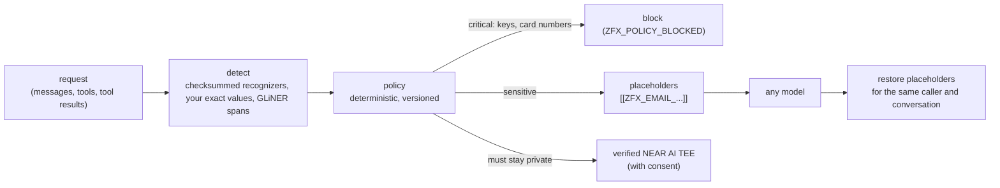

# How ZeroFlux works

ZeroFlux is the economic layer for AI compute: three products that share one network, NEAR, and one token, ZFX.

| | Product | In one sentence | Code | Live |
|---|---|---|---|---|
| Earn | ZFX Mining | GPUs and CPUs earn ZFX by running integer matrix math; NEAR referees every block | `crates/`, `miner/`, `bridge/near/zfx-mine-opt` | `zfx.zeroflux.testnet` |
| Build | ZFX VPN | A privacy gateway between apps and models: sensitive values become placeholders the model never sees | `vpn/` | local app; hosted gateway in the repo |
| Trade | ZFX Markets | A daily index of each AI model's spend on OpenRouter, and perpetuals on it that clear on NEAR | `markets/` | `oracle.zeroflux.testnet`, `perps-v2.zeroflux.testnet`, zeroflux.network/trade |



## Earn: ZFX Mining

**The work.** Each attempt runs a 64 → 4096 → 4096 → 4096 → 4096 → 256 network of integer layers (51.6 million multiply-adds) with weights derived from the epoch seed, then hashes the output. A hash below the target is a block. The challenge includes the miner's NEAR account, so a found solution can't be stolen. Spec: `CONSENSUS.md`; why this design: `ALGORITHM_DECISION.md`.

**Why GPUs.** The work is batched int8/FP8 matrix multiplication, which tensor cores run fastest. Measured on the production profile: NVIDIA B300 14.9 M attempts/s (FP8), AMD MI355X 13.1 M/s, H200 8.4 M/s, H100 8.1 M/s, RTX PRO 6000 4.8 M/s, RTX 4090 3.3 M/s, Apple M5 Pro GPU 80 K/s, the same chip's CPU 3.3 K/s. Every path is bit-exact against the reference on every device (`HARDWARE.md`, `bench/results/gpu_summary.json`, `bench/results/gpu-r6/summary.json`).

**How NEAR checks it without redoing it.** A block costs 51.6 M multiply-adds, far beyond one NEAR transaction. So blocks are checked optimistically:

```mermaid
sequenceDiagram
    participant M as Miner
    participant C as zfx.zeroflux.testnet
    participant W as Watcher
    M->>C: submit(height, nonce, trace) + 0.25 NEAR bond (about 6 Tgas)
    Note over C: checks the output hash against the target;<br/>block is pending for 10 minutes
    W->>W: recompute the trace on a CPU
    alt a value is wrong
        W->>C: challenge(height, layer, row) (about 4.5 Tgas)
        Note over C: recompute one value; revert the block and its descendants;<br/>the bond goes to the watcher
    else every value is right
        W->>C: finalize()
        Note over C: mint 50 ZFX to the miner, return the bond
    end
```

ZFX is a standard NEP-141 token, so it works in NEAR wallets and trades through NEAR Intents with no bridge (`tests/e2e/near_intents.py`). Details and measured gas: `NEAR_SETTLEMENT.md`. Mine on testnet: `scripts/mine-testnet.sh you.testnet mlx`.

## Build: ZFX VPN

A request from an app or coding agent goes to ZFX VPN instead of the model provider:



Three ways to run it, by who may see the raw prompt: the local daemon (only your machine), the hosted gateway (the operator, disclosed on every response), and hosted transport with local preprocessing (only your machine; the hosted side gets placeholders). Every request carries a privacy tier: `LOCAL_ONLY`, `TRANSFORMED_PUBLIC`, `ATTESTED_CONFIDENTIAL`, `UNVERIFIED_EXTERNAL`. Threat model: `VPN_THREAT_MODEL.md`; product docs: `vpn/README.md`.

## Trade: ZFX Markets

**The index.** For each model and UTC day: tokens from OpenRouter's documented daily dataset (CC BY 4.0) times a frozen billed share and input/output mix, times documented listed prices. That is implied spend in USD per day on one venue; it is not the model's revenue. Every value is an ed25519-signed `OraclePrint` in an append-only ledger with hash chains. Markets trade the 7-day average. Method: `DATA_METHOD.md`.

**Why it is hard to push.** Moving a 7-day spend index by 1% means buying 1% of the model's 7-day spend in real usage ($43K for Claude Opus 5.5 today). Open interest per market is capped at 25% of the 7-day spend, so the most a manipulator can win stays below what the push costs. A day that moves the index more than 25% (the 99th percentile of 22,654 observed moves) puts the market in close-only.

**Clearing on NEAR.** The operator matches signed orders off-chain; the contract checks every fill:

```mermaid
sequenceDiagram
    participant T as Trader (browser SDK)
    participant N as zfx-perps node
    participant R as Relayer
    participant C as perps-v2.zeroflux.testnet
    T->>N: order signed with a registered trading key
    N->>N: match (price-time priority, isolated margin check)
    R->>C: settle_batch(fills + both signed orders + index prints)
    Note over C: verifies both signatures, nonces, expiry, limits,<br/>policy hash, margin, OI cap, print signatures;<br/>a forged fill is rejected
    C-->>T: positions and collateral on-chain
```

The operator can delay or reorder orders, but it cannot forge a trade or move funds. If the operator disappears, users force-withdraw, then freeze the contract and take their settled balance. Messages, invariants and operator powers: `ORDERBOOK_AND_CLEARING.md`; parameters and stress results on real index history: `MARKET_RISK.md`.

**The oracle on NEAR.** `oracle.zeroflux.testnet` stores the signed 7-day prints of every tracked model (the dataset index markets settle on, and the web index, which covers models outside the dataset's top 50), so anyone (a contract or a skeptical trader) can read and re-verify the history on-chain.

## Status and limits

Everything runs on NEAR testnet; nothing handles real money. Per-product readiness, evidence and blockers (audits, counsel, a NEAR AI key for live confidential inference) are in `RELEASE_READINESS.md`. What existed before this work and what changed: `REPO_AUDIT.md`.
