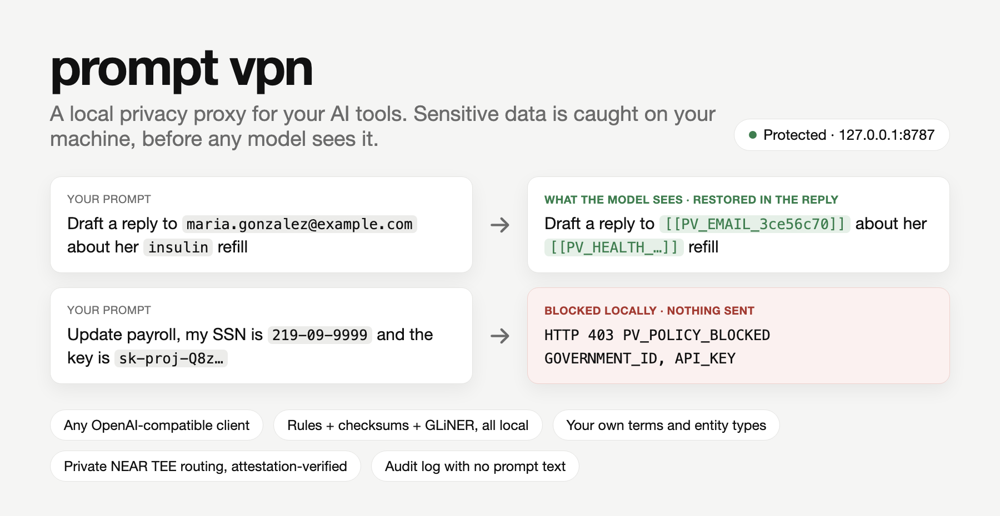
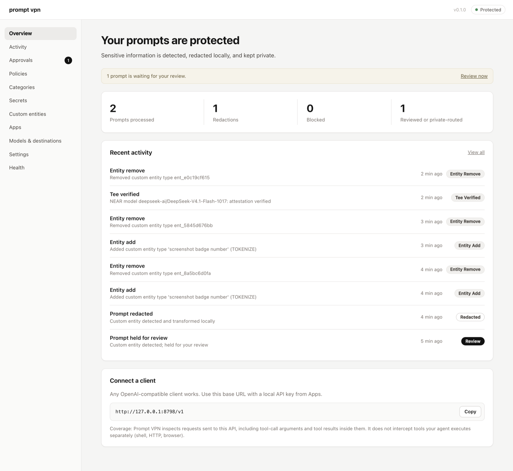
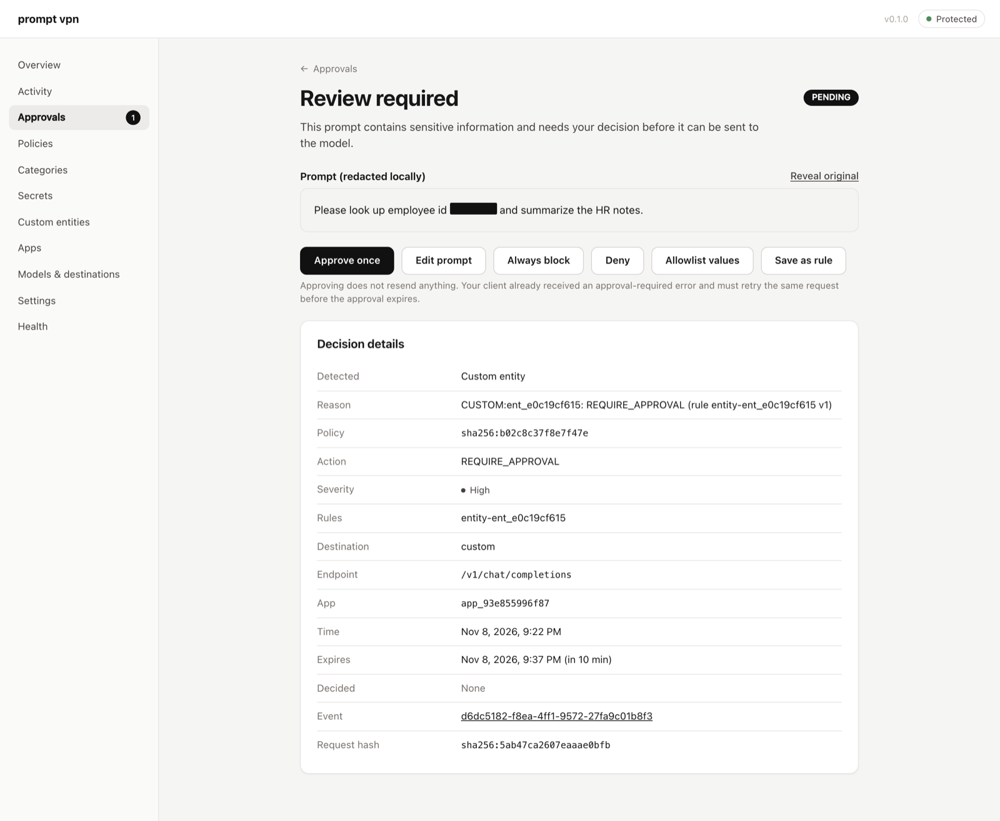
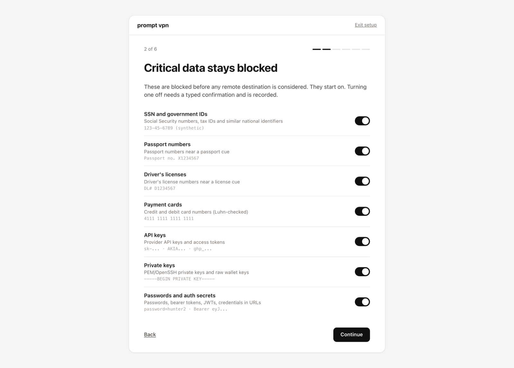
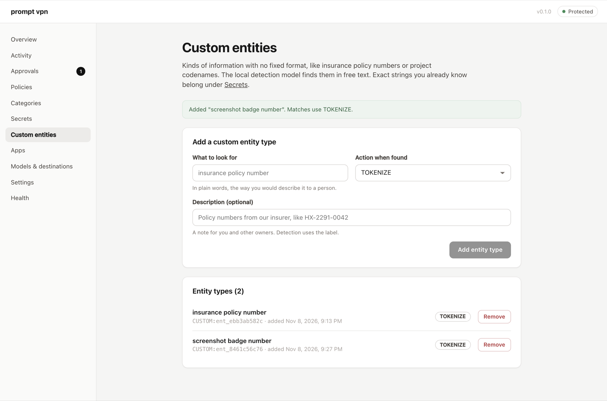

# Prompt VPN



Prompt VPN is a local privacy proxy for your AI tools. Point any OpenAI-compatible client at `http://127.0.0.1:8787/v1` and every request is checked on your machine first:

- **Blocked:** SSNs and government IDs, card numbers, API keys, private keys, passwords.
- **Swapped for placeholders, restored in the reply:** emails, phones, addresses, health details, and kinds of data you define yourself.
- **Held for you:** anything uncertain, or sent only to a NEAR AI model whose hardware enclave has just been verified, if you allow that.

Detection rules, your registered terms, placeholder mappings and the audit log never leave the device.

## Install

```sh
curl -fsSL https://raw.githubusercontent.com/numinousmuses/promptvpn/main/install.sh | sh
promptvpn init           # guided setup (or: promptvpn init --dashboard)
promptvpn connect test   # proves protection with synthetic data against a local mock
promptvpn dashboard
```

The installer builds from source with Rust (it offers to install Rust if missing), puts the binary in `~/.local/bin`, and never uses sudo. [Read it first](install.sh) if you like. macOS is the primary platform; Linux builds but is untested.

Then point a client at it:

```sh
export OPENAI_BASE_URL=http://127.0.0.1:8787/v1
export OPENAI_API_KEY="$(cat "<data dir>/apps/default.key")"   # path shown by `promptvpn connect show`
```

or let Prompt VPN edit a supported client's config with a backup: `promptvpn client configure codex|aider|opencode`, undo with `promptvpn client rollback <client>`. Coding agents can follow the setup skill in [skills/promptvpn-setup/SKILL.md](skills/promptvpn-setup/SKILL.md).

## See it

Demo videos, built from real terminal output and real dashboard screenshots: [overview (61 s)](docs/demo/promptvpn-overview.mp4) · [custom entity types (25 s)](docs/demo/promptvpn-custom-entities.mp4).

| Every decision is logged, never the values | Uncertain requests wait for you |
|---|---|
|  |  |
| **Critical protections are on from the start** | **Describe your own kinds of data** |
|  |  |

## How it fits

```
AI client ──> 127.0.0.1:8787/v1 ──> detect ──────────────> policy ──> allow / placeholder / redact / review / block
                                    rules + checksums       (deterministic,   │
                                    your exact terms         versioned)       └──> NEAR AI (verified TEE) │ local Ollama │ custom endpoint
                                    GLiNER span model
                                    (+ your custom entity types)
```

## What it covers, and what it does not

Prompt VPN inspects the requests your client sends to its API: every message, system prompt, tool definition, tool-call argument and tool result inside `/v1/chat/completions` and `/v1/responses`, plus the model's output on the way back.

It does **not** intercept anything an agent does outside that API. If a coding agent runs `curl`, reads a file and posts it somewhere, or drives a browser, Prompt VPN never sees it. It does not install root certificates, change system proxies or filter network traffic.

Other limits:
- Detection is not perfect. The benchmark in [docs/evaluation.md](docs/evaluation.md) reports measured misses; zero escapes on a finite corpus is not a proof of zero risk.
- Images, audio and files inside requests cannot be inspected. They are blocked for remote destinations by default.
- A NEAR TEE is remote. Verified attestation means the model runs in an attested enclave; it is not on-device processing.
- Local logs and the vault are MAC-chained and encrypted, which detects tampering and protects data at rest. They do not defend against an administrator of the same machine.

## How a request is handled

1. The caller authenticates with a local key (`pvk_...`). Requests with a foreign `Origin` or a non-loopback `Host` are refused.
2. Every content string is located by JSON pointer and classified:
   - built-in recognizers for 15 categories, with checksums (Luhn, IBAN mod-97, ABA, SSN ranges) and context cues, run over raw text plus Unicode-folded, unescaped and base64-decoded views;
   - your registered exact values, patterns and file fingerprints (encrypted at rest, matched in memory);
   - GLiNER PII (base by default), an embedded ONNX span model that labels each word: names, free-text addresses, health details, and any custom entity types you add (for example "insurance policy number").

   Every finding is an exact span, so anything can be swapped for a placeholder and restored. No model judges whole messages, and no Ollama is needed for detection.
3. A deterministic policy engine decides per finding. Scopes are user, agent, application; a lower scope cannot weaken a rule marked non-overridable. Model output never changes policy.
4. The request is then allowed, transformed (tokenize, redact, generalize), held for review, privately routed, or blocked. If the installed detection model fails or is missing, requests fail closed to review; they are never allowed unchecked. A model-only claim of critical data below 0.8 confidence goes to review instead of a hard block.
5. The response is inspected with outbound rules, redacted if needed, and placeholders are restored only for the caller and conversation that created them. Streams pass through a 256-byte hold-back so nothing is released before it has been checked.
6. A metadata-only event is recorded: categories, action, policy hash, recognizer versions, latency. Never prompt text or values.

Held requests return `PV_APPROVAL_REQUIRED` (HTTP 428) immediately. Approving in the dashboard does not resend anything; the client retries and the approval applies once, bound to that exact request, destination, policy version and transformed payload. Held payloads are encrypted and destroyed after 15 minutes.

## Destinations

| Tier | Example | Gets content that requires privacy? |
|---|---|---|
| `ATTESTED_TEE` | NEAR AI model that passes attestation now | Only with your consent |
| `LOCAL` | Ollama on loopback | Only if you enable local private handling |
| `EXTERNAL_UNVERIFIED` | Any other endpoint, including NEAR "Incognito" models | Never |

NEAR AI is the recommended provider. Attestation is verified with NEAR's official Rust SDK (`nearai-inference-sdk` 0.3.0): gateway TDX quote with TLS key binding, model TDX quotes, NVIDIA GPU evidence through NRAS (required), and per-response signatures. Prompt VPN adds `x-no-aliasing` and accepts only NEAR-operated attestable models. Private sends use field-level end-to-end encryption to the attested model key. A failed or unverified TEE is never replaced by an unverified endpoint.

## Error codes

`PV_POLICY_BLOCKED`, `PV_APPROVAL_REQUIRED`, `PV_CLASSIFIER_UNAVAILABLE`, `PV_UNSUPPORTED_CONTENT`, `PV_ROUTE_FORBIDDEN`, `PV_POLICY_INVALID`, `PV_VAULT_LOCKED`, `PV_PROVIDER_ERROR`, `PV_OUTPUT_BLOCKED`. Error bodies never contain matched values.

## Repository

```
crates/pv-core        typed contracts, policy engine, error envelope
crates/pv-detectors   recognizers, exact matcher, encoded views, GLiNER span adapter, custom entities
crates/pv-transform   tokenize/redact/generalize, scoped restoration
crates/pv-vault       XChaCha20-Poly1305 vault, OS keychain key set, rotation, recovery
crates/pv-audit       SQLite store, migrations, MAC-chained events, retention
crates/pv-provider    destinations, NEAR AI (official SDK), OpenAI-compatible upstreams
crates/pv-proxy       request pipeline, routing, approvals, output inspection, SSE
crates/pv-daemon      loopback server, auth, admin API, model manager, mock upstream
crates/pv-cli         the `promptvpn` binary
apps/dashboard        React dashboard, embedded in the binary
skills/promptvpn-setup  agent setup skill, scripts, tests, adapters
schemas/              JSON Schemas generated from the Rust types
third_party/gline-rs  vendored GLiNER runtime with two fixes for ModernBERT models
models.lock.json      pinned model revisions and hashes (no weights committed)
```

Docs: [threat model](docs/threat-model.md), [policy semantics](docs/policy-semantics.md), [operations](docs/operations.md), [evaluation](docs/evaluation.md), [deviations from the spec](docs/deviations.md), [build progress](docs/PROGRESS.md).

## Development

```sh
sh scripts/check.sh                          # everything: tests, dashboard, skill, privacy gate (no hosted CI)
cargo test --workspace                       # ~200 tests incl. HTTP integration, adversarial, approvals, routing
sh skills/promptvpn-setup/tests/run.sh       # skill script tests
cargo run -p pv-cli -- eval --configs all --models-dir <dir>   # benchmark deterministic + GLiNER edge/small/base
cd apps/dashboard && npm run dev             # dashboard against a running daemon
cargo test -p pv-provider --test live_near -- --ignored   # live NEAR attestation check
```

License: Apache-2.0. The GLiNER PII models are Apache-2.0.
